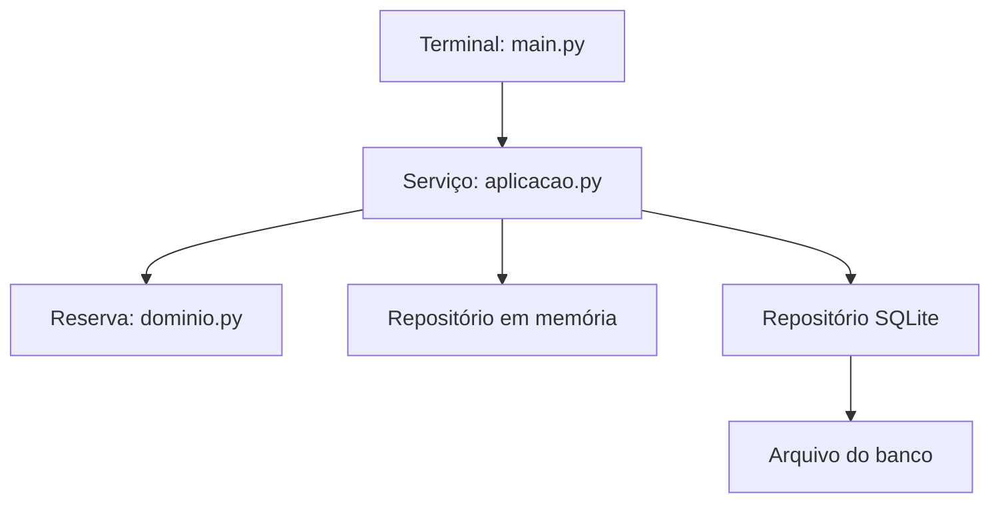

## Objetivo e organização

Nesta atividade, vocês montarão um pequeno sistema universitário de reservas de salas em camadas e testarão seu comportamento. **Todo o código-base está neste documento: não é necessário ter feito outra atividade nem possuir um projeto anterior.**

O foco é compreender a separação de responsabilidades e escrever testes. Por isso, a implementação-base é fornecida para copiar. Apenas os dois testes adicionais e as respostas teóricas deverão ser elaborados pelo grupo.

Ao final, vocês deverão distinguir testes do domínio, testes do serviço com persistência simulada e testes de integração com SQLite real.

**Sequência de aprendizagem:** implementar as regras e o serviço → testar o domínio → testar o serviço com um mock → implementar SQLite → verificar a integração real. O mock permite testar o serviço mesmo quando a implementação de persistência ainda não existe.

**Pré-requisitos:** reconhecer variáveis, funções, listas e `if`; Python 3.10 ou superior já instalado e editor disponível. Classes, construtores e asserções serão explicados no próprio roteiro. Não são necessários servidor de banco, navegador ou arquivos externos. O executor `unittest`, o SQLite e os mocks já fazem parte da biblioteca padrão das instalações usuais de Python. A atividade principal não exige instalar pacotes.

## 1. Visão geral: arquitetura em camadas

### 1.1 Problema e regras

O sistema cria e lista reservas de salas. Cada reserva tem sala, responsável, início e fim. As regras são:

1. Sala e responsável não podem ser vazios nem conter somente espaços.

2. O término deve ser posterior ao início; datas e horas são locais, sem fuso.

3. Duas reservas conflitam quando são da mesma sala e seus intervalos se sobrepõem.

4. Reservas consecutivas, como 9h–10h e 10h–11h, são permitidas: o término do intervalo é exclusivo.

5. Antes de criar a reserva, o serviço remove espaços nas extremidades e coloca o nome da sala em maiúsculas.

Exemplos: `A101`, 9h–10h, conflita com `A101`, 9h30–10h30; não conflita com `A102` no mesmo horário nem com `A101`, 10h–11h.

**Escopo:** este recorte não implementa autenticação, capacidade, cancelamento ou duração máxima. Não acrescentem essas regras aos testes.

### 1.2 Responsabilidades e dependências

Uma arquitetura em camadas distribui responsabilidades para reduzir o acoplamento e facilitar mudanças e testes. Aqui, o serviço recebe um objeto de armazenamento e usa dois métodos: `listar()` e `adicionar()`.

| Camada ou papel | Arquivo | Responsabilidade |
|---|---|---|
| Domínio | `dominio.py` | Entidade `Reserva`: validade e regra de conflito |
| Aplicação | `aplicacao.py` | `ServicoReservas`: normalizar, converter datas, verificar conflitos e solicitar gravação |
| Infraestrutura | `infraestrutura.py` | Primeiro memória; SQLite será acrescentado na seção 5 |
| Apresentação e composição | `main.py` | Demonstração no terminal e conexão das implementações |

A separação é lógica: apresentação e composição estão no mesmo arquivo pequeno para viabilizar o laboratório. Não será criada uma classe especial de contrato. Os dois repositórios oferecem os mesmos métodos: `listar()` e `adicionar()`. Esse acordo de uso basta para conectar os objetos neste exemplo.



**Como ler:** o terminal chama o serviço; o serviço usa a entidade e um dos repositórios. As duas opções de repositório são alternativas: cada serviço recebe somente uma delas. O SQL fica na infraestrutura.

Por exemplo, podemos conectar um repositório SQLite no lugar do de memória sem reescrever a regra de conflito. Nos testes, podemos conectar um mock. O serviço precisa que o objeto ofereça `listar()` e `adicionar()`, mas não precisa saber como ele armazena os dados. Apenas separar arquivos não seria suficiente se as responsabilidades continuassem misturadas.

### Guia rápido de Python usado nesta atividade

| Elemento | Significado e exemplo |
|---|---|
| `class Reserva:` | Define um tipo de objeto com dados e operações. |
| `__init__(self, ...)` | Construtor: executa quando criamos `Reserva(...)`. |
| `self` | O próprio objeto; `self.sala` guarda a sala daquela reserva. |
| Método | Função de um objeto, como `reserva.conflita_com(outra)`. |
| `raise ValueError(...)` | Interrompe a operação e sinaliza um dado inválido. |
| `strip()` / `upper()` | Remove espaços das extremidades / converte texto para maiúsculas. |
| `for item in lista:` | Percorre os elementos de uma lista. |
| `from modulo import Classe` | Permite usar uma classe definida em outro arquivo. |

O único método especial necessário no código da aplicação será `__init__`. Não haverá decoradores, anotações de tipo, classes abstratas ou geração automática de métodos. Ao longo da cópia guiada, concentrem-se nos campos do objeto e nos métodos que cada camada chama.

### 1.3 Os três focos de teste

| Foco | Dependências exercitadas | Classificação nesta atividade |
|---|---|---|
| Validade e conflito de `Reserva` | Objetos e datas fixas | Unitário do domínio |
| Serviço com repositório simulado | Domínio real; persistência isolada | Unitário do serviço com mock |
| Serviço, repositório e banco | Componentes e SQLite reais | Integração |

## 2. Montando o projeto

### 2.1 Criem a pasta e confiram o ambiente

No terminal, executem:

```sh
mkdir atividade_testes_camadas
cd atividade_testes_camadas
python --version
```

Antes da aula, preparem o ambiente. Se já houver um ambiente Python da disciplina, basta usá-lo. Caso contrário, criem um ambiente virtual na pasta do projeto:

```sh
python -m venv .venv
```

Ativem-no com **um** dos comandos apropriados ao sistema:

| Sistema / terminal | Comando |
|---|---|
| macOS ou Linux | `source .venv/bin/activate` |
| Windows — Prompt de Comando | `.venv\Scripts\activate.bat` |
| Windows — PowerShell | `.venv\Scripts\Activate.ps1` |

Confiram o ambiente:

```sh
python -c "import unittest, sqlite3; print('Ambiente pronto')"
```

Se a pasta já existir, usem uma nova pasta vazia. Se necessário, substituam `python` por `python3` ou `py` em todos os comandos.

Os próximos quatro blocos são **arquivos diferentes**. Salvem cada um com o nome indicado, na mesma pasta, usando UTF-8. Criem o arquivo de testes somente na seção 3.

| Arquivo | Quando criar |
|---|---|
| `dominio.py` | Seção 2.2 |
| `aplicacao.py` | Seção 2.3 |
| `infraestrutura.py` | Seção 2.4; ampliar na seção 5 |
| `main.py` | Seção 2.5 |
| `test_atividade.py` | Seções 3, 4 e 5 |
| `respostas.md` ou `respostas.txt` | Seção 7 |

### 2.2 Domínio: arquivo `dominio.py`

A entidade guarda os dados e rejeita estados inválidos. A regra de conflito pertence ao domínio e não precisa de banco. A normalização da sala será responsabilidade do serviço; os testes diretos de conflito usarão identificadores já normalizados.

```python
class Reserva:
    def __init__(self, sala, responsavel, inicio, fim):
        if sala.strip() == '' or responsavel.strip() == '':
            raise ValueError('Informe sala e responsável.')
        if fim <= inicio:
            raise ValueError('O término deve ser posterior ao início.')
        self.sala = sala
        self.responsavel = responsavel
        self.inicio = inicio
        self.fim = fim
    def conflita_com(self, outra):
        mesma_sala = self.sala == outra.sala
        horarios_sobrepostos = (
            self.inicio < outra.fim and outra.inicio < self.fim
        )
        return mesma_sala and horarios_sobrepostos
```

### 2.3 Aplicação: arquivo `aplicacao.py`

O serviço recebe um repositório no construtor: essa **injeção de dependência** permite conectá-lo a memória, SQLite ou um objeto simulado. Ele coordena o caso de uso, enquanto `Reserva` define o conflito.

```python
from datetime import datetime
from dominio import Reserva
class ServicoReservas:
    def __init__(self, repositorio):
        self.repositorio = repositorio
    def listar(self):
        return self.repositorio.listar()
    def reservar(self, sala, responsavel, inicio, fim):
        sala = sala.strip().upper()
        responsavel = responsavel.strip()
        data_inicio = datetime.fromisoformat(inicio)
        data_fim = datetime.fromisoformat(fim)
        reserva = Reserva(sala, responsavel, data_inicio, data_fim)
        reservas_existentes = self.repositorio.listar()
        for existente in reservas_existentes:
            if reserva.conflita_com(existente):
                raise ValueError('A sala já está reservada nesse intervalo.')
        self.repositorio.adicionar(reserva)
        return reserva
```

### 2.4 Primeira infraestrutura: armazenamento em memória

Criem `infraestrutura.py` apenas com a classe abaixo. Ela guarda reservas em uma lista e oferece os dois métodos que o serviço utiliza. A implementação SQLite será criada somente depois de testarmos o serviço com um mock.

```python
class RepositorioMemoria:
    def __init__(self):
        self.reservas = []

    def listar(self):
        return self.reservas.copy()

    def adicionar(self, reserva):
        self.reservas.append(reserva)
```

`append()` adiciona um objeto à lista. `copy()` devolve uma cópia da lista, evitando que uma alteração na coleção recebida modifique diretamente a coleção interna. Não se trata de uma cópia profunda dos objetos.

### 2.5 Apresentação e composição: arquivo `main.py`

Esta demonstração usa uma entrada fixa para evitar o tempo de construir menus. A função `main()` conecta os componentes e solicita uma reserva; `apresentar_reservas()` mostra o resultado sem SQL e sem recalcular conflitos.

```python
from aplicacao import ServicoReservas
from infraestrutura import RepositorioMemoria
def apresentar_reservas(servico):
    reservas = servico.listar()
    for reserva in reservas:
        print(
            f'{reserva.sala} | {reserva.responsavel} | '
            f'{reserva.inicio:%H:%M}–{reserva.fim:%H:%M}'
        )
def main():
    repositorio = RepositorioMemoria()
    servico = ServicoReservas(repositorio)
    servico.reservar(
        ' a101 ', ' Ana ',
        '2026-11-03T09:00', '2026-11-03T10:00',
    )
    apresentar_reservas(servico)
if __name__ == '__main__':
    main()
```

### 2.6 Executem a aplicação

```sh
python main.py
```

**Esperado:**

```text
A101 | Ana | 09:00–10:00
```

O `main.py` usa memória; cada execução começa vazia. O SQLite será conectado nos testes de integração, sem mudar o serviço.

Se houver `ModuleNotFoundError`, confiram os nomes dos arquivos e executem os comandos na pasta que contém todos eles. Não nomeiem arquivos como `unittest.py`, `sqlite3.py` ou `datetime.py`, pois isso ocultaria os módulos da biblioteca padrão.

## 3. Teste unitário

Um teste unitário avalia uma unidade de comportamento com condições controladas. Aqui, testaremos a regra de conflito de `Reserva`, sem serviço, banco de dados, terminal ou navegador. 

### 3.1 Conheçam o mínimo de `unittest`

| Elemento | Função nesta atividade |
|---|---|
| `unittest.TestCase` | Classe-base que fornece as verificações |
| Método `def test_...(self):` | Define um teste reconhecido pelo executor |
| `setUp()` | Prepara os objetos antes de cada método de teste |
| `self.assertTrue(x)` / `self.assertFalse(x)` | Verifica resultado verdadeiro ou falso |
| `self.assertEqual(observado, esperado)` | Compara os valores |
| `with self.assertRaises(ValueError):` | Verifica a exceção esperada |
| `self.addCleanup(acao)` | Agenda uma ação de limpeza para depois do teste |

Uma **asserção** torna a expectativa verificável pelo programa. Organizem os testes em **preparar → executar → verificar**. O resultado esperado vem das regras, não da saída observada.

Em `class TesteReservaUnitaria(unittest.TestCase)`, o trecho entre parênteses permite usar as verificações fornecidas pelo framework. `self` indica o objeto atual. Cada teste recebe sua própria preparação em `setUp()`; um teste não deve depender dos dados deixados por outro.

### 3.2 Criem `test_atividade.py` com este primeiro bloco

```python
import tempfile
import unittest
from datetime import datetime
from pathlib import Path
from unittest.mock import Mock

from aplicacao import ServicoReservas
from dominio import Reserva


class TesteReservaUnitaria(unittest.TestCase):
    def setUp(self):
        self.reserva = Reserva(
            'A101', 'Ana',
            datetime(2026, 11, 3, 9, 0),
            datetime(2026, 11, 3, 10, 0),
        )

    def test_detecta_sobreposicao_na_mesma_sala(self):
        # Preparar: outra reserva sobrepõe o intervalo da primeira.
        outra = Reserva(
            'A101', 'Bia',
            datetime(2026, 11, 3, 9, 30),
            datetime(2026, 11, 3, 10, 30),
        )

        # Executar.
        resultado = self.reserva.conflita_com(outra)

        # Verificar.
        self.assertTrue(resultado)

    def test_permite_salas_distintas_no_mesmo_horario(self):
        outra = Reserva(
            'A102', 'Bia', self.reserva.inicio, self.reserva.fim
        )
        self.assertFalse(self.reserva.conflita_com(outra))
```

Executem:

```sh
python -m unittest -v test_atividade.TesteReservaUnitaria
```

**Esperado:** `Ran 2 tests` e `OK`. O tempo varia. Para executar apenas um método:

```sh
python -m unittest -v test_atividade.TesteReservaUnitaria.test_detecta_sobreposicao_na_mesma_sala
```

Observem: usamos objetos reais de domínio e datas fixas. `setUp()` prepara uma nova reserva antes de cada método. O `Mock` importado será utilizado na próxima etapa e já faz parte da biblioteca padrão.

## 4. Testar o serviço antes de implementar SQLite

Até aqui, `infraestrutura.py` contém somente `RepositorioMemoria`: o componente SQLite ainda não foi implementado. Mesmo assim, podemos testar `ServicoReservas` porque ele depende apenas das operações `listar()` e `adicionar()`.

Um **mock** simula uma dependência e registra como ela foi utilizada. Vamos configurar a consulta para retornar uma lista vazia e verificar a solicitação de gravação. A injeção pelo construtor já existe no projeto; não é necessário alterar o código de produção nem usar `patch`.

Acrescentem ao mesmo `test_atividade.py`:

```python
class TesteServicoComMock(unittest.TestCase):
    def test_solicita_gravacao_da_reserva_normalizada(self):
        # Preparar: simular a consulta e registrar chamadas.
        repositorio = Mock()
        repositorio.listar.return_value = []
        servico = ServicoReservas(repositorio)

        # Executar.
        criada = servico.reservar(
            ' a101 ', ' Ana ',
            '2026-11-03T09:00', '2026-11-03T10:00',
        )

        # Verificar resultado e interações.
        self.assertEqual(criada.sala, 'A101')
        self.assertEqual(criada.responsavel, 'Ana')
        repositorio.listar.assert_called_once_with()
        repositorio.adicionar.assert_called_once_with(criada)
```

Executem:

```sh
python -m unittest -v test_atividade.TesteServicoComMock
```

**Esperado:** `Ran 1 test` e `OK`.

| Recurso | O que demonstra |
|---|---|
| `return_value = []` | Fornece uma resposta preparada à consulta |
| `Mock()` | Cria um objeto simulado; os nomes dos métodos devem ser escritos corretamente |
| `assert_called_once_with(criada)` | Verifica uma única chamada com a reserva indicada |

As verificações `assert_called_once_with()` pertencem ao próprio `Mock`; as verificações dos valores retornados usam `self.assertEqual()`.

**Classificação correta:** este é um **teste unitário do serviço com a persistência isolada**. Ele comprova que a gravação foi solicitada ao objeto simulado; não comprova execução de SQL ou persistência. A lista vazia configurada funciona como resposta de stub; o mesmo objeto também verifica interações como mock.

O teste já pode orientar a implementação futura: a consulta devolve uma lista de reservas e a inclusão recebe uma `Reserva`. O mock não valida se o futuro repositório cumprirá esse comportamento; isso exigirá testes com a implementação real.

Neste exemplo, o serviço já está pronto e o componente de persistência será implementado depois. Essa sequência mostra testes com uma dependência ainda indisponível; por si só, não demonstra o ciclo completo de TDD do serviço.

### Conferência antes de construir SQLite

```sh
python -m unittest -v test_atividade
```

**Esperado:** `Ran 3 tests` e `OK`: dois testes do domínio e um teste do serviço com mock. Nenhum deles importa ou instancia `RepositorioSQLite`, que ainda não existe.

## 5. Implementar SQLite e testar a integração

### 5.1 Acrescentem o repositório SQLite

Agora que o serviço foi testado com a dependência simulada, implementaremos a persistência real. **Não alterem `dominio.py` nem `aplicacao.py`.** Substituam o conteúdo de `infraestrutura.py` pelo bloco completo abaixo: ele conserva `RepositorioMemoria` e acrescenta `RepositorioSQLite`.

O SQL fica somente na infraestrutura. Os valores são enviados por parâmetros `?`, separados do texto SQL.

```python
import sqlite3
from datetime import datetime
from dominio import Reserva
class RepositorioMemoria:
    def __init__(self):
        self.reservas = []
    def listar(self):
        return self.reservas.copy()
    def adicionar(self, reserva):
        self.reservas.append(reserva)
class RepositorioSQLite:
    def __init__(self, arquivo):
        self.conexao = sqlite3.connect(arquivo)
        self.conexao.execute("""
            CREATE TABLE IF NOT EXISTS reservas (
                id INTEGER PRIMARY KEY,
                sala TEXT NOT NULL,
                responsavel TEXT NOT NULL,
                inicio TEXT NOT NULL,
                fim TEXT NOT NULL
            )
        """)
        self.conexao.commit()
    def adicionar(self, reserva):
        self.conexao.execute(
            'INSERT INTO reservas '
            '(sala, responsavel, inicio, fim) VALUES (?, ?, ?, ?)',
            (reserva.sala, reserva.responsavel,
             reserva.inicio.isoformat(), reserva.fim.isoformat()),
        )
        self.conexao.commit()
    def listar(self):
        registros = self.conexao.execute(
            'SELECT sala, responsavel, inicio, fim FROM reservas ORDER BY id'
        ).fetchall()
        reservas = []
        for registro in registros:
            sala, responsavel, inicio, fim = registro
            reserva = Reserva(
                sala, responsavel,
                datetime.fromisoformat(inicio),
                datetime.fromisoformat(fim),
            )
            reservas.append(reserva)
        return reservas
    def fechar(self):
        self.conexao.close()
```

O repositório mantém uma conexão aberta até `fechar()`. `execute()` executa SQL, `commit()` confirma a gravação e `fetchall()` recupera os registros. `listar()` percorre os registros e cria uma `Reserva` para cada um. `isoformat()` converte datas em texto; `datetime.fromisoformat()` reconstrói as datas.

Esta implementação é um recorte didático e não trata a concorrência entre solicitações. O `main.py` pode continuar usando memória; os testes conectarão o serviço ao SQLite.

### 5.2 Verifiquem a integração real

Um teste de integração avalia a colaboração entre partes do software. O caminho aqui é **serviço de aplicação → repositório SQLite → banco real**, com entidades reais. Ele verifica gravação, leitura e reconstrução dos dados. 

Acrescentem esta linha junto aos imports no início de `test_atividade.py`, pois a classe agora existe:

```python
from infraestrutura import RepositorioSQLite
```

Depois, acrescentem a classe abaixo ao final do mesmo arquivo:

```python
class TesteIntegracaoSQLite(unittest.TestCase):
    def setUp(self):
        self.pasta = tempfile.TemporaryDirectory()
        self.addCleanup(self.pasta.cleanup)
        self.arquivo = Path(self.pasta.name) / 'teste.db'
        self.repositorio = RepositorioSQLite(self.arquivo)
        self.addCleanup(self.repositorio.fechar)
        self.servico = ServicoReservas(self.repositorio)

    def test_grava_e_recupera_apos_recriar_repositorio(self):
        # Preparar e executar: serviço usa repositório e banco reais.
        criada = self.servico.reservar(
            ' a101 ', ' Ana ',
            '2026-11-03T09:00', '2026-11-03T10:00',
        )

        # Outro serviço e outro repositório leem o mesmo arquivo.
        outro_repositorio = RepositorioSQLite(self.arquivo)
        self.addCleanup(outro_repositorio.fechar)
        outro_servico = ServicoReservas(outro_repositorio)
        recuperadas = outro_servico.listar()

        # Comparar a quantidade e cada campo, sem comparar os objetos.
        self.assertEqual(len(recuperadas), 1)
        recuperada = recuperadas[0]
        self.assertEqual(recuperada.sala, 'A101')
        self.assertEqual(recuperada.responsavel, 'Ana')
        self.assertEqual(recuperada.inicio, criada.inicio)
        self.assertEqual(recuperada.fim, criada.fim)
```

Executem:

```sh
python -m unittest -v test_atividade.TesteIntegracaoSQLite
```

**Esperado:** `Ran 1 test` e `OK`. `setUp()` prepara um banco em uma pasta temporária nova antes de cada método. `self.arquivo` guarda seu caminho. Esse banco não utiliza dados da aplicação.

O teste recria o repositório para ler o mesmo arquivo usando outra conexão. Um banco SQLite `':memory:'` comum não é compartilhado automaticamente entre conexões; por isso usamos um arquivo temporário.

`self.addCleanup(acao)` registra uma ação para o fim do teste, inclusive se ele falhar. As ações são executadas na ordem inversa: fechar os repositórios antes de apagar a pasta. Ao criar outro repositório, registrem `self.addCleanup(outro_repositorio.fechar)`.

Comparem a quantidade e os quatro campos explicitamente: a classe simples `Reserva` não define igualdade por conteúdo.

### 5.3 Comparem as evidências

| Teste | Quando pode ser executado | Evidência |
|---|---|---|
| Serviço com mock | Antes de implementar SQLite | Normalização e solicitação das operações esperadas |
| Integração com SQLite | Depois de existir a implementação | Gravação, leitura e reconstrução com banco real |

```sh
python -m unittest -v test_atividade
```

**Esperado agora:** `Ran 4 tests` e `OK`. O serviço permanece o mesmo: mudamos o objeto recebido no construtor. Os dois níveis de teste se complementam. Não coloquem `unittest.main()` no meio do arquivo; os comandos acima já iniciam o executor.

## 6. Exercícios adicionais

Agora criem **dois novos métodos de teste**, sem alterar as regras da aplicação. Reservem aproximadamente cinco minutos para cada exercício. O código guiado é apoio; a solução adicional deve ser escrita pelo grupo.

### Exercício 1: Unitário: rejeitar intervalos inválidos

Dentro da classe `TesteReservaUnitaria`, acrescentem este método:

```python
    def test_rejeita_fim_igual_ou_anterior_ao_inicio(self):
        # Escrevam a solução aqui.
        pass
```

**Requisitos do teste:**

1. Usem início às 9h de `2026-11-03`.

2. Avaliem dois términos: 9h, igual ao início, e 8h59, anterior ao início.

3. Em ambos, construir `Reserva` deve levantar `ValueError`.

4. Usem dois blocos `with self.assertRaises(ValueError):`, um para cada cenário.

5. Não instanciem serviço, banco ou mock: a unidade avaliada é a validação da entidade.

**Dica de sintaxe: repitam este bloco para cada término:**

```python
with self.assertRaises(ValueError):
    # Criem uma Reserva com o intervalo inválido aqui.
    pass
```

`with self.assertRaises(ValueError):` significa: “a operação deste bloco deve levantar `ValueError`”. Escrevam a criação da reserva dentro do bloco, com quatro espaços adicionais. Substituam `pass` pela operação; deixá-lo fará essa verificação falhar.

**Aceitação:** os dois cenários são executados e verificados. Um `print`, um `try/except` que ignora o resultado ou um método contendo apenas `pass` não constituem solução.

### Exercício 2: Integração: conflito rejeitado sem gravação indevida

Dentro da classe `TesteIntegracaoSQLite`, acrescentem este método; ele receberá a preparação de `setUp()`:

```python
    def test_rejeita_conflito_sem_alterar_banco(self):
        # Escrevam a solução aqui.
        pass
```

**Cenário:**

1. Criem, pelo serviço, uma reserva da sala `A101`, responsável `Ana`, das 9h às 10h de `2026-11-03`.

2. Tentem reservar `' a101 '` para `Bia`, das 9h30 às 10h30 da mesma data. Os espaços e minúsculas devem ser normalizados pelo serviço.

3. Verifiquem `ValueError` na segunda chamada.

4. Criem outro `RepositorioSQLite` e outro `ServicoReservas`, usando o mesmo caminho `self.arquivo`.

5. Leiam as reservas e verifiquem que há uma única reserva, com **sala, responsável, início e fim iguais aos da reserva original**. Comparem cada campo, como no exemplo guiado.

**Dicas:** guardem o objeto devolvido pela primeira reserva. Usem `self.servico` e `self.arquivo`, já preparados por `setUp()`. Para o novo repositório, registrem `self.addCleanup(outro_repositorio.fechar)`, como no exemplo guiado. Verifiquem `len(reservas)` antes de acessar `reservas[0]` e comparem os quatro campos. Não usem `self.assertEqual(reservas, [original])`: esta classe não define igualdade por conteúdo.

**Aceitação:** SQLite deve ser real, temporário e isolado. Não substituam o repositório por mock neste exercício. Verifiquem tanto a rejeição quanto o estado persistido.

### Conferência dos exercícios

```sh
python -m unittest -v test_atividade
```

**Esperado com as soluções corretas:** `Ran 6 tests` e `OK`. O método do exercício 1 contém duas verificações de exceção, mas conta como um único teste.

Se aparecer `FAIL`, houve divergência em uma asserção. `ERROR` indica outra exceção inesperada, incluindo possíveis problemas de preparação ou import. Leiam o relatório para localizar a causa. Não removam asserções para obter `OK`.

## 7. Questões teóricas

Respondam em aproximadamente três a cinco linhas por questão, usando nomes de classes e métodos do projeto.

**Questão 1: Arquitetura e testabilidade**  

Por que `ServicoReservas` receber o repositório no construtor e usar apenas `listar()` e `adicionar()` facilita os testes? Expliquem como essa decisão permitiu alternar entre mock e SQLite sem alterar a regra de conflito. Qual seria o efeito de colocar SQL diretamente em `apresentar_reservas()`, no terminal?

**Questão 2: Alcance das evidências**  

Um colega afirma: “Se `repositorio.adicionar.assert_called_once_with(criada)` passou, a reserva está salva no SQLite”. Avaliem essa afirmação. Diferenciem a evidência produzida pelo teste com mock da produzida pelo teste com banco real e indiquem um comportamento do sistema que continua sem avaliação nesta atividade.

## 8. Entrega

Submetam um **arquivo pdf**, com identificação dos integrantes do grupo, contendo:

1. Os testes implementados.

2. Respostas às questões 1 e 2 e saída final do comando `python -m unittest -v test_atividade`. Registrem eventuais falhas ainda não resolvidas; não fabriquem resultados.

## 9. Tutorial extra: Primeiros passos com Ruff

**Complemento opcional:** aproximadamente 10 minutos adicionais, após concluir os exercícios. Este tutorial não altera a entrega da seção 8 nem faz parte dos 45 minutos da atividade principal.

### 9.1 Para que serve?

Ruff analisa arquivos Python sem executar a aplicação e também padroniza sua formatação. A análise estática complementa os testes: pode apontar, por exemplo, imports não utilizados e nomes não definidos. Testes com unittest verificam comportamentos em execução. A distinção entre atividades estáticas e dinâmicas de verificação é discutida por Pressman & Maxim e Sommerville.

| Ferramenta / comando | Uso neste projeto |
|---|---|
| `ruff check` | Procurar problemas indicados pelas regras habilitadas |
| `ruff format` | Padronizar a apresentação do código |
| `unittest` | Executar os testes de reservas |

Um relatório sem alertas não demonstra que a regra de conflito está correta. As ferramentas fornecem evidências diferentes.

### 9.2 Instalem no mesmo ambiente

Na pasta do projeto, com o ambiente virtual da seção 2 ativado, executem:

```sh
python -m pip install ruff
python -m ruff --version
```

Usem o mesmo comando `python` empregado para executar o unittest. Não é necessário criar um arquivo de configuração para este tutorial.

### 9.3 Analisem o projeto

Após completar os dois métodos dos exercícios, executem:

```sh
python -m ruff check .
```

O ponto significa a pasta atual. Leiam o arquivo, a linha e o código de cada diagnóstico. Dois exemplos úteis:

| Código | Significado |
|---|---|
| `F401` | Um import não foi utilizado |
| `I001` | O bloco de imports precisa ser organizado, se essa regra estiver habilitada |

A quantidade e a apresentação dos avisos podem variar com a versão e as regras habilitadas. Se não houver problemas detectados, é comum aparecer `All checks passed!`.

### 9.4 Experimentem um problema fácil de reconhecer

No início de `main.py`, acrescentem esta linha e salvem:

```python
import os
```

Não utilizem `os` no restante do arquivo. Executem:

```sh
python -m ruff check main.py
```

Procurem o diagnóstico **`F401`**, indicando que `os` foi importado, mas não utilizado. Ele pode aparecer junto de outros avisos. Essa identificação não exige executar `main.py`.

### 9.5 Apliquem uma correção automática

Executem:

```sh
python -m ruff check --fix main.py
```

Abram o arquivo novamente e observem a remoção do import não utilizado. O comando pode aplicar outras correções disponíveis, como organizar imports. Revisem as mudanças.

Agora analisem e apliquem as correções disponíveis no projeto inteiro:

```sh
python -m ruff check --fix .
```

Nem todo problema pode ser corrigido automaticamente; leiam os diagnósticos restantes e façam os ajustes indicados. Se um import necessário a uma etapa futura for removido, acrescentem-no novamente quando chegarem àquela etapa.

### 9.6 Padronizem a formatação

Primeiro, confiram quais arquivos precisariam mudar:

```sh
python -m ruff format --check .
```

Esse comando apenas verifica. Uma indicação de arquivos a formatar não é uma falha de execução da aplicação.

Depois, apliquem a formatação:

```sh
python -m ruff format .
```

Observem espaços, quebras de linha e aspas. A apresentação pode mudar sem alterar o comportamento pretendido. Formatar e corrigir diagnósticos são operações distintas; por isso, usamos os dois comandos.

### 9.7 Confiram novamente com unittest

```sh
python -m ruff check .
python -m ruff format --check .
python -m unittest -v test_atividade
```

Com os dois exercícios implementados corretamente, a suíte deve continuar com **`Ran 6 tests` e `OK`**. Se algum teste falhar, investiguem a mudança e o relatório antes de prosseguir.

**Observação:** identifiquem uma mudança sugerida pelo Ruff e expliquem oralmente se ela se refere à organização do código ou ao comportamento de uma reserva. Não é uma nova questão obrigatória para entrega.

**Referência técnica:** Astral. [Tutorial do Ruff](https://docs.astral.sh/ruff/tutorial/).
